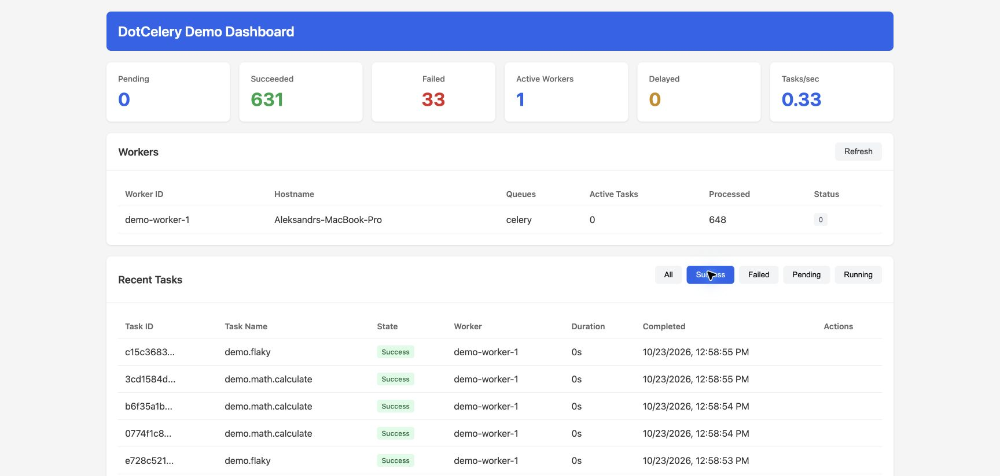
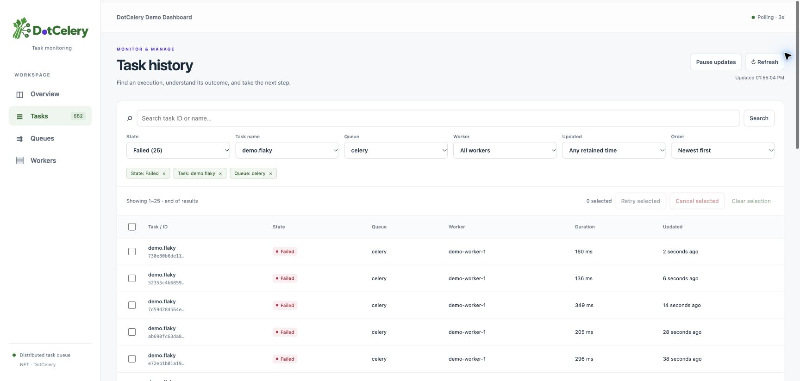
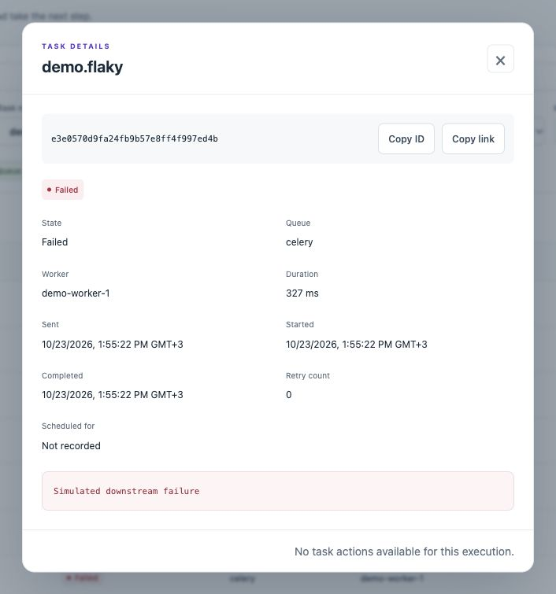

<h1></h1>

[](https://dotnet.microsoft.com/)
[](https://learn.microsoft.com/dotnet/csharp/)
[](LICENSE)

A distributed task queue for .NET 10, inspired by Python's [Celery](https://docs.celeryq.dev/). DotCelery provides asynchronous task execution, scheduling, and distributed processing with enterprise-grade reliability.

## Documentation

Use the [documentation index](docs/README.md) to choose the kind of help you need:

- [Tutorials](docs/tutorials/README.md): learn by running a task and exploring the dashboard.
- [How-to guides](docs/how-to/README.md): complete a specific setup or development task.
- [Reference](docs/reference/README.md): look up packages, contracts, API routes, and defaults.
- [Explanation](docs/explanation/README.md): understand execution, delivery, and architecture.

New to DotCelery? Start with [Run your first task](docs/tutorials/first-task.md).

## Features

### Core Features
- **Distributed Task Execution** - Execute tasks asynchronously across multiple workers
- **Multiple Brokers** - RabbitMQ, Redis Streams, Amazon SQS, In-Memory (Azure Service Bus planned)
- **Result Backends** - Redis, PostgreSQL, SQL Server, MongoDB, In-Memory
- **Canvas Workflows** - Chain, Group, and Chord primitives, dispatched by workers
- **Beat Scheduler** - Periodic task scheduling with cron and interval support
- **OpenTelemetry** - Built-in distributed tracing and metrics for sends, completions, retries, queue time, and in-progress tasks

### Enterprise Features
- **ETA/Countdown** - Schedule tasks for future execution with delayed message store
- **Task Cancellation** - Revoke running or pending tasks with real-time notifications
- **Dashboard UI** - Web-based monitoring UI and SignalR hub, with built-in data providers and live updates
- **Rate Limiting** - Sliding window algorithm for task throttling
- **Batches** - Grouped task submission with completion tracking and completion callbacks
- **Saga State Machine** - Long-running business process coordination
- **Compensating Actions** - Automatic rollback when saga steps fail
- **Progress Reporting** - Real-time task progress updates during execution
- **Circuit Breaker** - Fault tolerance with automatic recovery, gating each queue's consumption
- **Kill Switch** - Emergency task execution control
- **Multi-Tenancy** - Tenant isolation with queue routing

### Modern C# 14
- **`field` Keyword** - Semi-auto properties with validation
- **`params ReadOnlySpan<T>`** - Zero-allocation variadic methods
- **Operators in Classes** - Fluent API support (`chain + signature`)

See [ROADMAP.md](ROADMAP.md) for known gaps in the features above and for planned features.

## Quick Start

### Installation

```bash
dotnet add package DotCelery.Core
dotnet add package DotCelery.Client
dotnet add package DotCelery.Worker
dotnet add package DotCelery.Analyzers
dotnet add package DotCelery.Broker.RabbitMQ
dotnet add package DotCelery.Backend.Redis
```

`DotCelery.Analyzers` supplies the source generator: it registers the tasks an assembly defines
(`RegisterTasks()`) and attaches the typed invokers, so no task is invoked through expression
compilation. It is optional — without it, register tasks by hand with `AddTask<TTask>()` or scan
with `AddTasksFromAssembly`, and the worker falls back to the compiled invoker.

See the [package reference](docs/reference/packages.md) for package responsibilities,
provider registration names, and build requirements.

### Canvas Workflow Example

The repository includes a runnable sample that sends a chain, a group, a chord with a callback, and
a nested canvas over the in-memory transport, checking every result:

```bash
dotnet run --project samples/DotCelery.CanvasExample
```

### Local Redis/Postgres Example

The repository includes a runnable sample that uses Redis Streams as the broker and PostgreSQL as the default result backend:

```bash
docker compose up -d redis postgres
dotnet run --project samples/DotCelery.RedisPostgresExample
```

The same sample can store task results in Redis:

```bash
dotnet run --project samples/DotCelery.RedisPostgresExample -- --result-backend=redis
```

### Define a Task

```csharp
using DotCelery.Core.Abstractions;

public sealed class SendEmailTask : ITask<EmailInput, EmailResult>
{
    public static string TaskName => "email.send";

    public Task<EmailResult> ExecuteAsync(
        EmailInput input,
        ITaskContext context,
        CancellationToken ct)
    {
        // Send email logic here
        ct.ThrowIfCancellationRequested();
        return Task.FromResult(new EmailResult(Success: true));
    }
}

public record EmailInput(string To, string Subject, string Body);
public record EmailResult(bool Success);
```

The analyzer package also contains a source generator: for every assembly that defines tasks it
emits an internal `DotCelery.Generated.DotCeleryTasks.RegisterTasks()` extension that registers
each of them under its static `TaskName` through a typed reference and attaches a typed adapter
that invokes the task, so neither registration nor invocation needs reflection or expression
compilation. It also records the input and output types it knows with each registration, so the
worker's registry does not inspect the task's interfaces. Call it from the same assembly instead
of scanning:

```csharp
using DotCelery.Generated;

builder.Services.AddDotCelery(celery =>
    celery
        .AddWorker()
        .RegisterTasks());
```

For each task with a known input, the generator also emits a typed signature helper named after
the task without its `Task` suffix (`SendEmailTask` → `SendEmail`), so a canvas is written without
spelling out the type arguments:

```csharp
using static DotCelery.Generated.DotCeleryTasks;

var workflow = new Group(
    SendEmail(new EmailInput("user1@example.com", "Hello", "...")),
    SendEmail(new EmailInput("user2@example.com", "Hello", "...")));
```

A library that ships tasks calls the generated method from its own public registration method,
since the generated class and its helpers are internal to the assembly that defines the tasks.
`AddTasksFromAssembly` stays available for the reflective scan.

### Configure Services

```csharp
var builder = Host.CreateApplicationBuilder(args);

builder.Services.AddDotCelery(celery =>
{
    celery
        .UseRabbitMQ(options =>
        {
            options.ConnectionString = "amqp://localhost";

            // Queues are declared with these arguments (a priority queue by default). Set
            // x-queue-type, x-dead-letter-exchange, x-message-ttl, x-max-length and the like
            // to match your deployment.
            options.QueueArguments["x-queue-type"] = "quorum";
        })
        .UseRedis(options =>
        {
            options.ConnectionString = "localhost:6379";
        })
        .AddClient()
        .AddWorker()
        .AddTasksFromAssembly(typeof(Program).Assembly);
});

var host = builder.Build();
await host.RunAsync();
```

Every broker is held to one delivery contract — message fields round-trip, delivery is addressed,
settlement settles, and an unsettled message whose consumer stops is delivered again — which a
shared conformance suite checks on each broker. `IBrokerCapabilities` (implemented by every
bundled broker) declares what a broker guarantees beyond that contract: priority delivery,
native delayed delivery, redelivery when a consumer stops, and the maximum message size it
accepts.

### Send Tasks

```csharp
public class EmailService(ICeleryClient celery)
{
    public async Task<AsyncResult<EmailResult>> SendWelcomeEmailAsync(string userEmail)
    {
        var asyncResult = await celery.SendAsync<SendEmailTask, EmailInput, EmailResult>(
            new EmailInput(userEmail, "Welcome!", "Thanks for signing up."));

        return asyncResult;
    }

    public async Task<EmailResult> SendAndWaitAsync(string userEmail)
    {
        var asyncResult = await celery.SendAsync<SendEmailTask, EmailInput, EmailResult>(
            new EmailInput(userEmail, "Hello", "World"));

        var result = await asyncResult.GetAsync(timeout: TimeSpan.FromSeconds(30));

        return result;
    }
}
```

## Canvas Workflows

DotCelery executes workflows built from `Chain`, `Group`, and `Chord` primitives. Send them with
`ICanvasClient` (registered by `AddCanvasClient()`); the client assigns the task IDs up front and
they come back in the result.

These examples assume an `IMessageSerializer` named `serializer` (for example, `new JsonMessageSerializer()`).

### Chain - Sequential Execution

```csharp
var fetch = new Signature
{
    TaskName = FetchDataTask.TaskName,
    Args = serializer.Serialize(new FetchInput(url)),
};

var transform = new Signature { TaskName = TransformTask.TaskName };
var save = new Signature { TaskName = SaveTask.TaskName };

var chain = fetch.Then(transform).Then(save);

var chainResult = await canvasClient.SendChainAsync(chain);
```

Each step runs after the previous one succeeds, with the previous result as its input; a step that
fails stops the chain. The last step's result is read with its task ID:

```csharp
var result = await client.WaitForResultAsync(chainResult.LastTaskId);
```

### Group - Parallel Execution

```csharp
var group = new Group(
    new Signature
    {
        TaskName = SendEmailTask.TaskName,
        Args = serializer.Serialize(new EmailInput("user1@example.com", "Hi", "Body")),
    },
    new Signature
    {
        TaskName = SendEmailTask.TaskName,
        Args = serializer.Serialize(new EmailInput("user2@example.com", "Hi", "Body")),
    },
    new Signature
    {
        TaskName = SendEmailTask.TaskName,
        Args = serializer.Serialize(new EmailInput("user3@example.com", "Hi", "Body")),
    }
);

var groupResult = await canvasClient.SendGroupAsync(group);
```

The members run in parallel. Chords need the batch store that tracks them (`AddBatchClient()` or
an `IBatchStore` registration plus `AddBatchSupport()` on the worker).

### Chord - Parallel + Callback

```csharp
var chord = new Group(
    new Signature
    {
        TaskName = FetchPriceTask.TaskName,
        Args = serializer.Serialize(new PriceInput("AAPL")),
    },
    new Signature
    {
        TaskName = FetchPriceTask.TaskName,
        Args = serializer.Serialize(new PriceInput("GOOGL")),
    },
    new Signature
    {
        TaskName = FetchPriceTask.TaskName,
        Args = serializer.Serialize(new PriceInput("MSFT")),
    }
).WithCallback(new Signature { TaskName = AggregateTask.TaskName });

var chordResult = await canvasClient.SendChordAsync(chord);
```

The callback runs once, in whichever worker settles the last header task, when every header task
has finished — whether it succeeded or failed. The callback receives the input given in its
signature, and the batch ID is on its message, so it can read the header results.

A signature can also carry callbacks of its own: `Link` runs when the task succeeds, with the
task's result as its input, and `LinkError` runs when it fails, with a `TaskErrorInfo` payload
(the failed task's ID, name, and error). A chain carries each step's callbacks to that step, and
a message is settled only after its callback is published, so a callback is not lost.

Canvases nest. A member of a group is any canvas primitive — a signature, a chain (which runs
its steps in order), or another group (flattened into its members) — so `new Group(chain, signature)`
mixes them, and a chord's header may do the same. A chain member completes with its last step,
which is what the group's result and a chord's batch track, so
`new Group(chain1, chain2).WithCallback(callback)` runs the callback once both chains finished,
and `group.Then(callback)` is that same chord under the workflow name. A chord cannot itself be a
member of a group; see [ROADMAP.md](ROADMAP.md#known-gaps).

## Saga State Machine

Coordinate long-running business processes with automatic compensation on failure.

Register sagas with `AddSagaSupport()`, which adds the orchestrator and the handlers that advance and compensate them; it requires an `ISagaStore` registration, such as `AddPostgresSagaStore()`.

```csharp
var saga = new Saga
{
    Id = Guid.NewGuid().ToString(),
    Name = "OrderProcessing",
    State = SagaState.Created,
    CreatedAt = DateTimeOffset.UtcNow,
    Steps =
    [
        new SagaStep
        {
            Id = "step-1",
            Name = "Reserve Inventory",
            Order = 0,
            ExecuteTask = new Signature { TaskName = ReserveInventoryTask.TaskName, Args = orderArgs },
            CompensateTask = new Signature { TaskName = ReleaseInventoryTask.TaskName }
        },
        new SagaStep
        {
            Id = "step-2",
            Name = "Charge Payment",
            Order = 1,
            ExecuteTask = new Signature { TaskName = ChargePaymentTask.TaskName, Args = paymentArgs },
            CompensateTask = new Signature { TaskName = RefundPaymentTask.TaskName }
        },
        new SagaStep
        {
            Id = "step-3",
            Name = "Ship Order",
            Order = 2,
            ExecuteTask = new Signature { TaskName = ShipOrderTask.TaskName, Args = shippingArgs }
            // No compensation - shipping cannot be undone
        }
    ]
};

// Start the saga - if step 3 fails, steps 1 and 2 are compensated automatically
var startedSaga = await sagaOrchestrator.StartAsync(saga);
```

## Progress Reporting

Report task progress in real-time during execution.

```csharp
public sealed class ProcessFileTask : ITask<FileInput, FileResult>
{
    public static string TaskName => "file.process";

    public async Task<FileResult> ExecuteAsync(
        FileInput input, ITaskContext context, CancellationToken ct)
    {
        var lines = await File.ReadAllLinesAsync(input.Path, ct);

        for (int i = 0; i < lines.Length; i++)
        {
            // Replace this simulated work with your asynchronous line processing.
            await Task.Delay(TimeSpan.FromMilliseconds(10), ct);

            // Report progress
            await context.Progress.ReportAsync(
                percentage: (i + 1) * 100.0 / lines.Length,
                message: $"Processing line {i + 1} of {lines.Length}",
                cancellationToken: ct);
        }

        return new FileResult(lines.Length);
    }
}

public record FileInput(string Path);
public record FileResult(int LinesProcessed);
```

## Batches

Submit groups of tasks and track their completion.

```csharp
var batchId = await batchClient.CreateBatchAsync(batch =>
{
    batch.WithName("email-campaign");
    batch.Enqueue<SendEmailTask, EmailInput, EmailResult>(new EmailInput("user1@example.com", "Newsletter", body));
    batch.Enqueue<SendEmailTask, EmailInput, EmailResult>(new EmailInput("user2@example.com", "Newsletter", body));
    batch.OnComplete<CampaignCompleteTask, CampaignCompleteInput>(
        new CampaignCompleteInput("email-campaign"));
});

var batchState = await batchClient.WaitForBatchAsync(batchId, timeout: TimeSpan.FromMinutes(1));
```

Sending batches requires `AddBatchClient()`. Batch state tracking requires an `IBatchStore` registration and `AddBatchSupport()` on the worker. The worker that settles the last task of a batch runs the `OnComplete` callback once, however the batch finished, with the input given to it and the batch ID on the message; the batch record is created before its tasks are published, so a task that finishes immediately is still counted.

## Beat Scheduler

Schedule periodic tasks with cron expressions or intervals.

```csharp
using DotCelery.Core.Serialization;

var serializer = new JsonMessageSerializer();

builder.Services.AddBeatScheduler(schedule =>
{
    // Run daily at midnight
    schedule.AddCron(
        "cleanup-daily",
        "0 0 * * *",
        CleanupTask.TaskName,
        serializer.Serialize(new CleanupInput()));

    // Run every 5 minutes
    schedule.AddInterval(
        "health-check",
        TimeSpan.FromMinutes(5),
        HealthCheckTask.TaskName,
        serializer.Serialize(new HealthCheckInput()));
});
```

An entry first runs one interval, or at its next cron occurrence, after the scheduler starts. `BeatOptions.PersistState` with `StatePath` carries the last run times across restarts, so a restarted scheduler resumes each schedule; `RunMissedOnStartup` decides whether a run missed while the scheduler was stopped is run once at startup or skipped. When a storage provider is registered, the schedulers that share it elect one of themselves per `SchedulerName`, and only that one runs the schedule; without storage every scheduler runs it.

## Task Configuration

### Using Attributes

```csharp
[Route("high-priority")]
[RateLimit("100/m")]
[TimeLimit(SoftLimitSeconds = 300, HardLimitSeconds = 360)]
public sealed class ProcessOrderTask : ITask<OrderInput, OrderResult>
{
    public static string TaskName => "orders.process";

    public async Task<OrderResult> ExecuteAsync(
        OrderInput input,
        ITaskContext context,
        CancellationToken ct)
    {
        try
        {
            // Replace with your asynchronous order processing.
            await Task.Delay(TimeSpan.FromMilliseconds(10), ct);
            return new OrderResult(Success: true);
        }
        catch (TransientException ex)
        {
            context.Retry(countdown: TimeSpan.FromSeconds(30), exception: ex);
            throw;
        }
    }
}
```

### Programmatic Retry

```csharp
public Task<OrderResult> ExecuteAsync(
    OrderInput input,
    ITaskContext context,
    CancellationToken ct)
{
    if (context.RetryCount < context.MaxRetries)
    {
        context.Retry(countdown: TimeSpan.FromSeconds(10));
    }

    throw new InvalidOperationException("Max retries exceeded.");
}
```

### Retry Policies

A retry policy computes the backoff before a retry and decides which exceptions are worth
retrying. Set one per task with `[Retry]`, or worker-wide with `UseResilience()`; a task's
attribute wins over the worker default. A requested retry without an explicit countdown uses
the computed backoff, and `AutoRetryOnFailure` turns a retryable failure into a retry instead
of a failure while retries remain. `MaxRetriesLimit` (default 100) clamps the
publisher-supplied `MaxRetries` on every message.

```csharp
[Retry(MaxRetries = 5, Strategy = BackoffStrategy.Exponential, InitialDelaySeconds = 2,
    DontRetryFor = new[] { typeof(ArgumentException) })]
public sealed class ProcessOrderTask : ITask<OrderInput, OrderResult> { ... }

builder.Services.AddDotCelery(celery =>
{
    celery
        .AddWorker()
        .UseResilience(options =>
        {
            options.DefaultRetryPolicy = RetryPolicy.Exponential(maxRetries: 3);
            options.AutoRetryOnFailure = true;
        });
});
```

## Resilience

### Circuit Breaker

Prevent cascade failures with automatic circuit breaking. Each queue has its own circuit, and a
global circuit covers failures that affected every queue. While a circuit is open, the messages
of the affected queue are returned to the broker instead of being run, so a failing dependency is
not hammered; once it closes again they flow normally. Infrastructure failures — an unavailable
result backend, for example — feed the queue circuit and the global one, and a successful task
clears the queue's failure count. A task's own failure does not trip a circuit: retries and the
dead letter queue handle it.

```csharp
builder.Services.AddDotCelery(celery =>
{
    celery
        .AddWorker()
        .UseCircuitBreaker(options =>
        {
            options.FailureThreshold = 5;
            options.FailureWindow = TimeSpan.FromMinutes(1);
            options.OpenDuration = TimeSpan.FromSeconds(30);
        });
});
```

### Kill Switch

Emergency control to stop task execution.

```csharp
builder.Services.AddDotCelery(celery =>
{
    celery
        .AddWorker()
        .UseKillSwitch(options =>
        {
            options.ActivationThreshold = 10;
            options.TripThreshold = 0.15;
            options.RestartTimeout = TimeSpan.FromMinutes(1);
        });
});
```

## Observability

### OpenTelemetry Integration

```csharp
builder.Services.AddOpenTelemetry()
    .WithMetrics(metrics =>
    {
        metrics.AddDotCeleryInstrumentation();
    })
    .WithTracing(tracing =>
    {
        tracing.AddDotCeleryInstrumentation();
    });
```

### Available Metrics

The client records sends, and the worker records tasks it receives, completes (with duration), retries, queue time, and how many run at once. Distributed tracing is emitted as well.

| Metric | Description |
|--------|-------------|
| `dotcelery.tasks.sent` | Tasks sent |
| `dotcelery.tasks.received` | Tasks received by workers |
| `dotcelery.tasks.succeeded` | Tasks completed successfully |
| `dotcelery.tasks.failed` | Tasks that failed |
| `dotcelery.tasks.retried` | Task retries |
| `dotcelery.tasks.duration` | Task execution duration (ms) |
| `dotcelery.tasks.queue_time` | Time tasks spend in queue before processing (ms) |
| `dotcelery.tasks.in_progress` | Tasks currently being processed |

## Dashboard

The [dashboard demo](samples/DotCelery.Dashboard.Demo) runs an in-memory worker and generates
sample traffic. Start it with `dotnet run --project samples/DotCelery.Dashboard.Demo`, then open
<http://localhost:5080/celery/>.

The overview brings together live queue and worker gauges, completion trends, and recent activity.
The dashboard uses the same DotCelery logo and green/purple brand colors as this README:



<details>
<summary>Explore task filtering and details</summary>

Task history combines state, task name, queue, worker, time, and text filters before pagination.
The demo deliberately generates occasional failures to demonstrate investigation. Task details
show timings, retries, and the error information permitted by the host configuration.





</details>

The **Overview**, **Tasks**, **Queues**, and **Workers** views share refresh controls and a visible
last-update timestamp. Pause updates to inspect a snapshot; selecting tasks also holds the list
steady while you review an action. Filters and task links can be bookmarked. Request failures
keep the previous data visible and mark it as potentially stale.

Retry and cancellation controls follow the host's permissions and configured stores. Before a
bulk action, the UI previews eligible task IDs and reports partial failures. A retry requires a
retained dead-letter entry; a failed task record alone is insufficient. Cancellation is shown as
requested until the worker reports the outcome. To browse the demo in read-only mode, run:

```bash
dotnet run --project samples/DotCelery.Dashboard.Demo -- --Dashboard:ReadOnly=true
```

The React/TypeScript UI, compiled Tailwind CSS, and logo are embedded in `DotCelery.Dashboard`;
serving the dashboard needs no external scripts, CDN, or Node.js runtime. Building from source
requires Node.js 24.3 or later. Run `npm ci` and `npm run check` for frontend linting,
formatting, type checking, and presentation tests; `npm run test:browser` runs the Chromium
regression suite. See [frontend development](docs/how-to/develop-dashboard.md) for hot reload.

REST clients must use an explicit API version, such as `/celery/api/v1/overview`
or `/celery/api/v1/tasks/search`. Unversioned URLs and unsupported versions return
404. Responses advertise supported versions; version-aware API Explorer metadata
is available for host OpenAPI integration. See the [API version policy](docs/reference/dashboard-api.md#versioning-and-discovery).

Add the dashboard to a host that also runs a worker. With the default in-memory worker registry it
shows the workers of its own process; a shared registry (see the note below) shows workers in other
processes too:

```csharp
using DotCelery.Backend.Postgres.Extensions;
using DotCelery.Broker.RabbitMQ.Extensions;
using DotCelery.Core.Extensions;
using DotCelery.Dashboard.Extensions;
using DotCelery.Worker.Extensions;

var builder = WebApplication.CreateBuilder(args);

builder.Services.AddDotCelery(celery =>
    celery
        .UseRabbitMQ(options => options.ConnectionString = "amqp://localhost")
        .UsePostgres(options =>
            options.ConnectionString = "Host=localhost;Database=celery")
        .AddWorker()
        .UseQueueMetrics());

// These stores share the PostgreSQL connection configured above.
builder.Services.AddPostgresQueueMetrics();
builder.Services.AddPostgresHistoricalDataStore();

// Every worker and dashboard configured with this storage shares the registry, so the dashboard
// sees workers in other processes; without one it sees the workers of its own process
builder.Services.AddPostgresWorkerRegistry();

builder.Services.AddDotCeleryDashboard(o =>
{
    o.PathPrefix = "/celery";
    o.RequireAuthorization = true; // wire AuthorizationCallback to your app's auth
});

var app = builder.Build();

app.UseDotCeleryDashboard();               // the UI page
app.MapDotCeleryDashboard("/celery");      // API controllers + SignalR hub

await app.RunAsync();
```

What the dashboard shows out of the box:

- **Workers** — the worker registers itself and heartbeats its live active and processed task
  counts (`WorkerOptions.WorkerHeartbeatInterval`), and unregisters when it stops. A worker that
  stops without unregistering is marked unresponsive after `DashboardOptions.WorkerOfflineTimeout`,
  and its record is removed after another pass or expires after
  `StorageStoreOptions.WorkerRetention` when a shared registry is used.
- **Tasks** — every task a dashboard host runs is recorded (id, name, state, worker, timings,
  error) and expires after `DashboardOptions.TaskRecordRetention`. Listing by state, listing by
  name, and counting states are indexed, and the list of task names the filter offers is kept in
  a marker per name that expires with the records.
- **Queues** — waiting/running/processed counts from the queue metrics store. The bundled
  brokers record each message they publish as it enters its queue and `UseQueueMetrics()` records
  the tasks that start and finish, so a queue's waiting count follows the messages in it; a host
  that only sends tasks records its publishes too once it registers a queue metrics store. The
  consumers of each queue come from the worker registry: the online workers whose registered
  queues contain it (a queue no online worker lists keeps what the metrics store reports, which
  is zero for the bundled stores).
- **Metrics** — the window aggregated from the historical data store when one is registered
  (`DashboardMetricsCollector` records per-queue and per-task snapshots every
  `DashboardOptions.MetricsSnapshotInterval`, so the per-task breakdown outlives the task
  records), and otherwise computed live from the task records.
- **Live updates** — the bundled page polls at `DashboardOptions.RefreshIntervalSeconds`,
  pauses while inspecting task details or confirming actions, and supports manual refresh.
  SignalR also exposes task and worker events for custom clients through
  `DashboardNotificationService`.

The default `IWorkerRegistry` is in-memory, so it sees only workers in the same process. To
monitor workers in other processes — and to count their consumers in the queue panel — register
a registry shared with them: `AddRedisWorkerRegistry`, `AddPostgresWorkerRegistry`,
`AddSqlServerWorkerRegistry`, `AddMongoWorkerRegistry`, or `AddInMemoryWorkerRegistry`, each
taking the options of the storage the hosts share. The dashboard keeps a registry the
application registered before it, and otherwise registers the in-process one; a custom
implementation can also be registered with `AddDotCeleryDashboard<TWorkerRegistry>()`.

The middleware serves the UI page only; paths under the prefix that belong to the API (`/api`)
or the hub (`/hub`) pass through to their endpoints, so `MapDotCeleryDashboard` works whether the
middleware runs before or after routing.

The API is fail-secure: authorization runs before a request body is bound, and until
`AuthorizationCallback` is wired to your app's auth every request is denied
(`RequireAuthorization` defaults to true). State-changing requests (revoke, retry, bulk
operations, filter previews) must also carry the dashboard request header, which a browser
cannot send cross-site, and an allowed origin — the bundled UI does this for you; script
clients set `X-DotCelery-Dashboard: 1` (see `VerifyRequestOrigin` and `AllowedOrigins`).
Paging and bulk operations are bounded by `PageSize` and `MaxBulkOperationSize`.

## Redis Storage

Every Redis store keeps its data under one key prefix. Register the result backend with `UseRedis` and each other store with its `AddRedis...` method; every registration configures the same `RedisStorageOptions` and shares one connection per connection string.

```csharp
builder.Services.AddRedisOutboxStore(options =>
{
    options.ConnectionString = connectionString;
    options.KeyPrefix = "billing:";
});
```

Expiry follows the application's clock rather than Redis key expiry, so processes that share Redis need synchronized clocks. Expired entries are deleted every `StorageStoreOptions.PurgeInterval`.

## MongoDB Storage

Every MongoDB store keeps its data in a few collections of one database (`dotcelery_documents`, `dotcelery_leases`, `dotcelery_queue_items`, `dotcelery_counters`, `dotcelery_windows`, and `dotcelery_sequences`). Register the result backend with `UseMongo` and each other store with its `AddMongo...` method; every registration configures the same `MongoStorageOptions` and shares one client per connection string. Indexes are created on first use.

```csharp
builder.Services.AddMongoOutboxStore(options =>
{
    options.ConnectionString = connectionString;
    options.DatabaseName = "jobs";
});
```

Stores are notified of new results and revocations through a capped collection (`dotcelery_notifications`) read with tailable cursors, which works without a replica set. Where capped collections are not available, set `UseNotifications = false`; the stores then poll. As with Redis, expiry follows the application's clock, and expired entries are deleted every `StorageStoreOptions.PurgeInterval`.

## PostgreSQL Schema

PostgreSQL stores get their tables from versioned migrations. Every store keeps its data in the same few storage tables (`dotcelery_documents`, `dotcelery_leases`, `dotcelery_queue_items`, `dotcelery_counters`, and two tables for rate limit windows). Register the result backend with `UsePostgres` and each other store with its `AddPostgres...` method; every registration configures the same `PostgresStorageOptions` and adds the migrations for the storage tables.

```csharp
builder.Services.AddPostgresOutboxStore(options =>
{
    options.ConnectionString = connectionString;
    options.Schema = "celery";
});
```

Retention, retries, and timeouts of the stores are set with `StorageStoreOptions`, whose `Prefix` keeps applications that share a database apart:

```csharp
using DotCelery.Core.Storage.Stores;

builder.Services.Configure<StorageStoreOptions>(options =>
{
    options.Prefix = "billing";
    options.ResultExpiry = TimeSpan.FromHours(6);
    options.InboxRetention = TimeSpan.FromDays(1);
});
```

Expired rows are deleted every `StorageStoreOptions.PurgeInterval` (5 minutes by default).

Pending migrations run while the host starts, before the worker starts, under a PostgreSQL advisory lock, so several processes can start at the same time. Applied migrations are recorded with a checksum in a `dotcelery_migrations` table in each schema. Without a generic host, resolve `SqlMigrator` and call `MigrateAsync()` before using the stores.

To apply schema changes yourself, turn off `RunAtStartup` and generate a script from the same configuration. The script applies only migrations that are not recorded yet, so it can be run again after each upgrade.

```csharp
builder.Services.AddPostgresMigrations(options => options.RunAtStartup = false);

// For example, in a deployment tool that shares the application's service configuration
var script = host.Services.GetRequiredService<SqlMigrator>().GenerateScript();
```

## SQL Server Storage

SQL Server stores use the same storage tables and versioned migrations as PostgreSQL, in the `dbo` schema by default. Register the result backend with `UseSqlServer` and each other store with its `AddSqlServer...` method; every registration configures the same `SqlServerStorageOptions`.

```csharp
builder.Services.AddSqlServerOutboxStore(options =>
{
    options.ConnectionString = connectionString;
    options.Schema = "celery";
});
```

Migrations run at startup under an application lock (`sp_getapplock`), and `AddSqlServerMigrations(options => options.RunAtStartup = false)` with `SqlMigrator.GenerateScript()` produces a script to apply by hand, as with PostgreSQL. Text columns use a binary collation, so keys are case-sensitive whatever the database collation. SQL Server has no simple publish/subscribe, so result waits and revocations poll every `StorageStoreOptions.ResultPollInterval` and `RevocationPollInterval`. An application uses one SQL database type for its stores: PostgreSQL or SQL Server.

### Transactional Outbox and Inbox

The PostgreSQL and SQL Server providers can write an outbox message or inbox record in the application's own database transaction, so it commits or rolls back together with the business change:

```csharp
await using var transaction = await db.Database.BeginTransactionAsync();
await db.SaveChangesAsync();

await outbox.StoreAsync(
    new OutboxMessage { Id = Guid.NewGuid().ToString("N"), TaskMessage = message, CreatedAt = DateTimeOffset.UtcNow },
    transaction.GetDbTransaction());

await transaction.CommitAsync();
```

The record is written on the transaction's connection and is dispatched or counted as processed only if the transaction commits. A provider that cannot write in the caller's transaction (in-memory, Redis, MongoDB) refuses the record with `NotSupportedException` instead of storing it outside the transaction.

The worker uses the same mechanism for task outcomes. With `UseInboxDeduplication()` and a result backend and inbox store that share a PostgreSQL or SQL Server provider, a successful task's result and its inbox record commit in one transaction. The worker acknowledges the delivery after that commit, and deduplication skips a redelivery while the completed outcome is retained. Delivery remains at least once: a crash before outcome recording can repeat execution and business effects. When the stores cannot share a transaction, the result is stored first and the inbox record afterwards; without an inbox store, there is no completed-delivery deduplication.

## Native AOT and Trimming

`DotCelery.Core`, `DotCelery.Worker`, `DotCelery.Client`, `DotCelery.Broker.InMemory`, and `DotCelery.Backend.InMemory` are marked `IsAotCompatible` and compile without AOT or trim warnings. The dashboard and the driver-based providers (RabbitMQ, Redis, SQS, PostgreSQL, SQL Server, MongoDB) are not covered by this verification.

A Native AOT application registers its tasks through the source generator, which supplies a typed invoker for each task so none is invoked through `Expression.Compile`, and registers its payload types with a source-generated `JsonSerializerContext`:

```csharp
builder.Services.Configure<JsonMessageSerializerOptions>(options =>
    options.Context = MyJsonContext.Default);

builder.Services.AddDotCelery(celery => celery
    .UseInMemoryBroker()
    .UseInMemoryBackend()
    .RegisterTasks() // Extension in the generated DotCelery.Generated namespace
    .AddClient()
    .AddWorker());

[JsonSourceGenerationOptions(PropertyNamingPolicy = JsonKnownNamingPolicy.CamelCase)]
[JsonSerializable(typeof(MyInput))]
[JsonSerializable(typeof(MyOutput))]
internal sealed partial class MyJsonContext : JsonSerializerContext;
```

DotCelery's own model types keep coming from the built-in `DotCeleryJsonContext`, so the application's context only registers its inputs and results. A payload type that neither context registers is an error at runtime, not a reflection fallback. The reflective scan (`AddTasksFromAssembly`) is annotated `[RequiresUnreferencedCode]`, and `UsePreventOverlapping` (keying by input) and `UseQueuedSignalDispatch` carry `[RequiresUnreferencedCode]` and `[RequiresDynamicCode]`, so an AOT or trimmed build warns when it uses a path that needs reflection.

`samples/DotCelery.AotSmoke` is a complete example; `just aot-smoke` publishes it for the host platform and runs it, as does CI.

## Production Checklist

- **Durable providers.** Use a shared broker (RabbitMQ, Redis, or SQS), a shared result backend, and storage-backed stores configured on storage every host shares. The in-memory broker, backend, and stores keep their data in the process and are meant for tests and samples.
- **Schema migrations.** PostgreSQL and SQL Server register their migrations with a generic host and apply them at startup under a database lock. A deployment that applies schema changes itself runs `SqlMigrator.GenerateScript()` once and applies the output through its migration process before rolling out.
- **Shared worker data.** Workers register themselves with `IWorkerRegistry`. A dashboard running in another process needs a registry on shared storage (`AddRedisWorkerRegistry`, `AddPostgresWorkerRegistry`, `AddSqlServerWorkerRegistry`, or `AddMongoWorkerRegistry`), not the in-process default.
- **Dashboard access.** The dashboard denies requests until `AuthorizationCallback` is wired and `RequireAuthorization` is enabled (the default), and state-changing requests must carry the dashboard request header and come from an allowed origin. Serve it over HTTPS.
- **Message security.** Schema-version and payload-size validation run for every message by default, and the worker warns at startup when signing, the task allowlist, or tenant validation is off. Enable `MessageSecurityOptions.EnableMessageSigning` with a `SigningKey`, keep `RejectUnsignedMessages` on, set `MaxMessageAge` to the longest acceptable redelivery delay, and enable the task allowlist (`EnforceTaskAllowlist` and `AllowedTaskNames`). For shared tenants, [configure independent tenant signing keys, explicit authorized queues, scoped storage, and dashboard claims](docs/how-to/isolate-tenants.md). `JsonMessageSerializerOptions.EnforceDeserializationTypeAllowlist` additionally restricts payload types.
- **Retention.** Size `StorageStoreOptions.ResultExpiry`, `InboxRetention`, `RevocationRetention`, and `WorkerRetention` to the replay window and dashboard history you need, and keep `AddStoragePurge()` registered so expired entries are deleted every `PurgeInterval`.
- **Dead letters.** Monitor the dead-letter store and configure broker and worker dead-lettering for the deployment; a rejected or exhausted message is not retried silently.
- **Observability.** Register health checks with `AddDotCelery()` on the `IHealthChecksBuilder`, and export metrics and traces with `AddDotCeleryInstrumentation()` on the meter and tracer providers.
- **Scheduling.** Run one Beat scheduler per schedule: with shared storage the schedulers elect one leader per `SchedulerName`. Shared storage retains cursors and pending occurrences across hosts; without storage, `PersistState` uses a local file. Decide `RunMissedOnStartup`.
- **Time limits.** Hard time limits are cooperative: a task that ignores its cancellation token keeps its worker slot, so bound such work inside the task.
- **Native AOT.** Only Abstractions, Core, Worker, Client, the in-memory broker and backend, and the generated registration and JSON contexts are verified for AOT and trimming; the dashboard and the driver-based providers are not.
- **Versions.** DotCelery targets .NET 10 and follows semantic versioning for its public API, which the packages track in `PublicAPI.Shipped.txt` and `PublicAPI.Unshipped.txt`.

## Project Structure

```
dotcelery/
├── src/
│   ├── DotCelery.Abstractions/      # Interfaces, models, options, and JSON contracts
│   ├── DotCelery.Core/              # Storage stores, serialization, and core registration
│   ├── DotCelery.Client/            # Task sending client, batch client
│   ├── DotCelery.Worker/            # Worker, sagas, resilience, progress
│   ├── DotCelery.Beat/              # Beat scheduler for periodic tasks
│   ├── DotCelery.Cron/              # Cron expression parser
│   ├── DotCelery.Dashboard/         # Web dashboard with SignalR
│   ├── DotCelery.Broker.InMemory/   # In-memory broker (testing)
│   ├── DotCelery.Broker.RabbitMQ/   # RabbitMQ broker
│   ├── DotCelery.Broker.Redis/      # Redis Streams broker
│   ├── DotCelery.Backend.InMemory/  # In-memory backend (testing)
│   ├── DotCelery.Backend.Redis/     # Redis backend
│   ├── DotCelery.Backend.Postgres/  # PostgreSQL backend
│   ├── DotCelery.Backend.SqlServer/ # SQL Server backend
│   ├── DotCelery.Backend.Mongo/     # MongoDB backend
│   ├── DotCelery.Storage.Sql/       # SQL schema model, migrations, and storage primitives
│   ├── DotCelery.Telemetry/         # OpenTelemetry instrumentation
│   └── DotCelery.Analyzers/         # Roslyn analyzers for task definitions
├── tests/
│   ├── DotCelery.Tests.Unit/        # Unit tests (xUnit v3)
│   ├── DotCelery.Tests.Integration/ # Integration tests (Testcontainers)
│   ├── DotCelery.Tests.Conformance/ # Tests that every storage provider runs
│   └── DotCelery.Analyzers.Tests/   # Analyzer tests
├── samples/                         # Demo, dashboard demo, canvas example, Redis/PostgreSQL example
└── benchmarks/                      # BenchmarkDotNet benchmarks
```

## Requirements

- .NET 10.0 or later
- C# 14

### Broker Requirements

| Broker | Version |
|--------|---------|
| RabbitMQ | 3.8+ |
| Redis | 5.0+ (Streams) |
| Amazon SQS | Standard queues (LocalStack is used for the tests) |

### Backend Requirements

| Backend | Version |
|---------|---------|
| Redis | 6.0+ |
| PostgreSQL | 12+ |
| SQL Server | 2016+ (or Azure SQL Database) |
| MongoDB | 5.0+ |

## Testing

```bash
# Run all tests
dotnet test

# Run unit tests only
dotnet test tests/DotCelery.Tests.Unit

# Run integration tests (requires Docker)
dotnet test tests/DotCelery.Tests.Integration
```

Integration tests use [Testcontainers](https://testcontainers.com/) to spin up RabbitMQ, Redis, PostgreSQL, SQL Server, and MongoDB containers automatically. SQL Server images are x86-64 only, so on ARM machines Docker must emulate them (Docker Desktop: "Use Rosetta for x86_64/amd64 emulation").

## Contributing

Contributions are welcome! Please read our [Contributing Guidelines](CONTRIBUTING.md) before submitting a pull request.

```bash
git clone https://github.com/kidoz/dotcelery.git
cd dotcelery
dotnet restore
dotnet build
dotnet test tests/DotCelery.Tests.Unit
```

## License

This project is licensed under the MIT License - see the [LICENSE](LICENSE) file for details.

## Acknowledgments

- Inspired by [Celery](https://docs.celeryq.dev/) for Python
- Built with [.NET 10](https://dotnet.microsoft.com/) and [C# 14](https://learn.microsoft.com/dotnet/csharp/)
