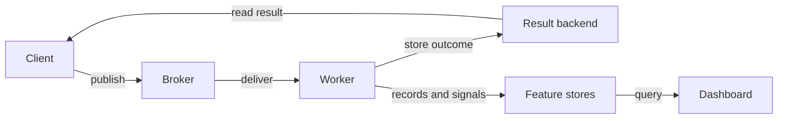

# System architecture

[Explanation](README.md) / System architecture

A DotCelery task crosses three main boundaries: a client publishes a message, a
broker delivers it, and a worker invokes the registered task. A result backend
lets clients read the outcome without keeping a connection to the worker.

## Transport and persistence solve different problems

The broker carries work. A result backend retains task states and results.
Feature stores support capabilities such as revocation, delayed messages,
dead letters, worker registries, and orchestration state. These responsibilities
have separate interfaces and registrations.

This is why a deployment can use Redis Streams for transport and PostgreSQL for
results. It is also why configuring a result backend does not automatically
enable every optional feature.

## Shared store behavior is implemented once

Storage-backed feature stores build on common primitives: documents, leases,
queues, counters, and notifications. Provider packages implement those primitives
for in-memory storage, Redis, PostgreSQL, SQL Server, or MongoDB. Shared conformance
cases exercise the resulting store contracts across providers.

SQL providers share schema operations and migration machinery. They retain their
own dialect and locking behavior. An applied SQL migration is historical input,
not a file to edit after deployment.

## Process boundaries matter

An in-memory broker, backend, or registry belongs to its process. It is useful
for the first-task lesson because all participants run together. Moving a worker
or dashboard into another process requires shared providers for the information
those hosts need to exchange.

The dashboard's default worker registry is one example: a remote worker does not
become visible merely because both hosts enable the dashboard. They must share
the registry's storage and naming configuration.

## Registration and compatibility

Task names are message-facing identities. The worker needs a registration for
the names clients publish, along with compatible input and output contracts.
Generated registration supplies typed invokers and supports the verified Native
AOT path. Assembly/package names and task names serve different purposes.

For exact package boundaries, use [Packages](../reference/packages.md). For what
can repeat after a failure, read [Delivery and retries](delivery-and-retries.md).
The [roadmap](../../ROADMAP.md) distinguishes implemented features from gaps and
plans.

Source: [abstractions](../../src/DotCelery.Abstractions),
[shared storage stores](../../src/DotCelery.Core/Storage/Stores), and
[conformance tests](../../tests/DotCelery.Tests.Conformance).
